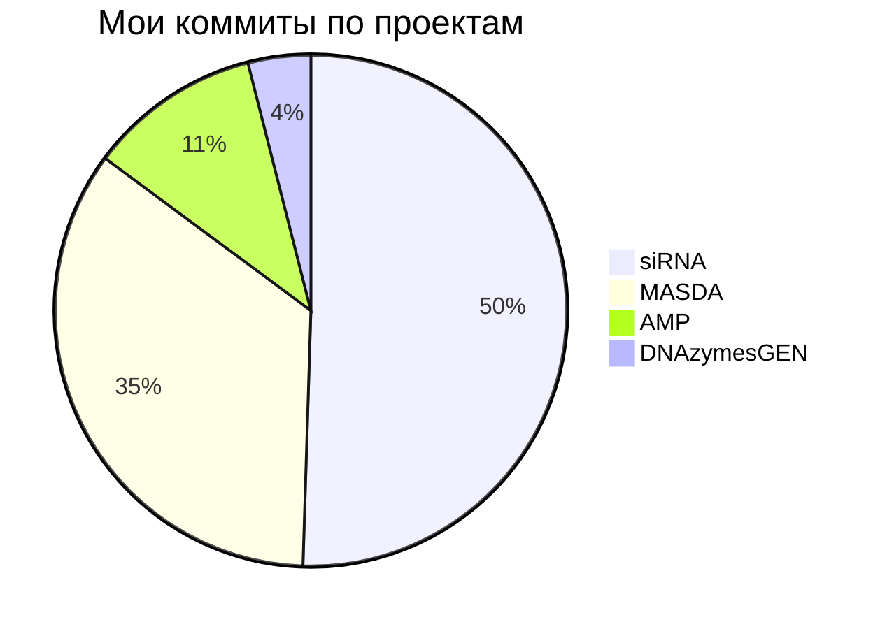
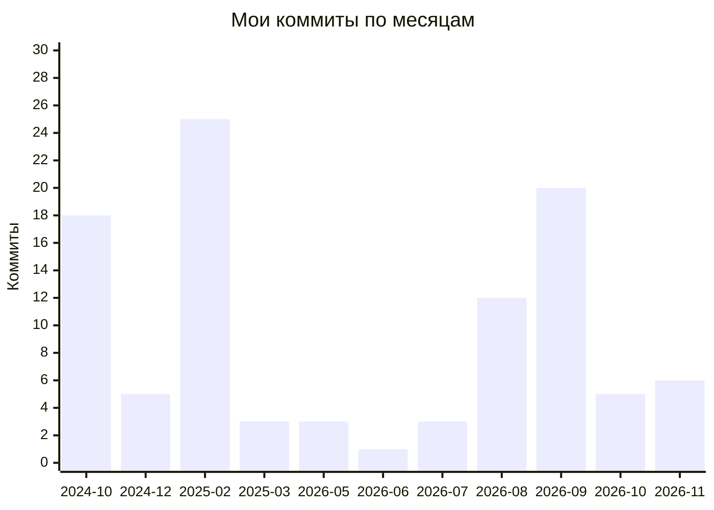

# Иван Головкин

Машинное обучение для химии и биологии. Университет ИТМО.

<table>
<tr>
<td width="50%" valign="top">

### [MASDA](https://github.com/gurinboru/MASDA_Datasets)

Мультиагентная система: по запросу находит табличные датасеты, скачивает и склеивает их в одну таблицу. Поиск, ранжирование, конкатенация источников, валидация, деплой.

`█████░░░░░░░░░░░░░░░` **27%**

**35 из 130** коммитов

</td>
<td width="50%" valign="top">

### [AMP Challenge](https://github.com/ai-chem/AMP_competition)

Генерация антимикробных пептидов на условном ProtGPT3 с LoRA. 2 место, NeurIPS 2026.

`████████░░░░░░░░░░░░` **42%**

**11 из 26** коммитов

</td>
</tr>
<tr>
<td width="50%" valign="top">

### [DNAzymesGEN](https://github.com/GenerativeMolMachines/DNAzymesGEN)

Генеративные модели и иерархический скрининг каталитических ядер ДНКзимов.

`███████████░░░░░░░░░` **57%**

**4 из 7** коммитов

</td>
<td width="50%" valign="top">

### [siRNA](https://github.com/GenerativeMolMachines/siRNA)

Предсказание нокдауна генов химически модифицированными siRNA. SOTA, RMSE = 12.

`███████████████████░` **94%**

**51 из 54** коммитов

</td>
</tr>
</table>

## Графики

Доля моих коммитов среди всех авторов. Числа — счётчик вкладов GitHub.

```mermaid
xychart-beta
    title "Мои коммиты и коммиты остальных"
    x-axis ["MASDA", "AMP", "DNAzymesGEN", "siRNA"]
    y-axis "Коммиты" 0 --> 100
    bar "Я" [35, 11, 4, 51]
    bar "Остальные" [95, 15, 3, 3]
```

Куда пришлись мои 101 коммит в этих четырёх репозиториях.

Мои коммиты по месяцам. Между мартом 2025 и маем 2026 в этих репозиториях коммитов не было.

